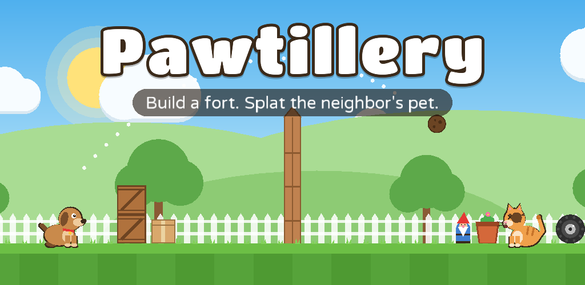

# Pawtillery

A turn-based backyard throwing game for Android, for kids and grown-ups.

Two neighbors' pets live on either side of a garden fence. First each player **builds a fort** from household junk to protect their pet. Then they take turns **throwing messy things over the fence**. Every hit fills the other pet's **mess meter**. A pet at 100% mess loses; after 10 throws each, the cleaner pet wins.

## Play it on your phone

**Easiest: download the APK GitHub builds for you.** Every push to `main` runs the *Build* workflow (Actions tab), which tests the game, builds the Android app and publishes it as the **Latest build** release.
1. On your phone, open <https://github.com/manpreetgugga/pawntery/releases/download/latest-build/pawtillery.apk> (or the repository's **Releases** > **Latest build** > `pawtillery.apk`).
2. Open the downloaded file. Android asks you once to allow installing apps from your browser or Files app.
3. If Google Play Protect warns about an unknown app, tap **More details** > **Install anyway**. It's a test build signed with a test key (`android/debug.keystore`), not yet by your Play account.

Every test build is signed with that same key, so a newer APK installs straight over the older one and keeps your treats and progress. (APKs built before October 28, 2026 used a random key: uninstall that one once first.)

The same APK is also kept for 90 days as the **pawtillery-debug-apk** artifact (a zip) on each Actions run.

### Automatic updates (test builds)

Once a test build is on the phone, it keeps itself up to date. Each time the menu opens (at most every half hour) it looks at `update.json` in the **Latest build** release. When GitHub has built a newer version, the game downloads it in the background, shows a progress bar on the menu and then offers **New version ready! Install / Later**. Android's installer asks once more before anything is installed; the very first time, Android also asks you to allow Pawtillery to install apps. Treats, pets and stars are kept. *Settings > Check for updates* checks right away.

Each GitHub build is numbered (`1.0.0 (test build N)`), and only a higher number counts as newer. This lives only in the test builds (`android/src/debug`): the Google Play version has no internet access and no install permission (the build checks this every time), because Play updates store apps itself and doesn't allow apps to update themselves. Builds from before this feature can't update themselves: install the latest one by hand once.

Or build it yourself in Android Studio (see [Build the Android app](#build-the-android-app)).

## What makes it different

| | Pocket Tanks | Angry Birds | Cat vs Dog | **Pawtillery** |
|---|---|---|---|---|
| You build your own defense | no | no (levels are fixed) | no | **yes: 6 pieces, real physics** |
| Opponent | another tank | fixed pigs | another pet | **another pet who also builds** |
| Damage | health/points | destruction | health | **mess meter, nothing violent, plus forts that crack and break** |
| Special throws | weapon list | bird powers | power-ups | **per-pet signature throw, big throws and four power-ups** |

## How to play

- **Build:** tap a piece (box, crate, plank, flower pot, gnome, tire), then touch your yard to drop it. Pieces stack and topple for real. "Turn" rotates, "Undo" takes the last one back, "Auto" builds a fort for you.
- **Throw:** drag back anywhere and let go, like a slingshot. Further back throws harder. For precise, repeatable shots, use the **angle and power** steppers (one degree or one percent per tap, hold to repeat) and tap **Throw!**. Your aim is kept between turns, so you can adjust from your last throw.
- **Trick shots:** a boomerang that hits on its way back, a bowling ball or shell that banks off something first, two or more split pieces or Triple throws landing (Double!, Triple!), or a firework popped right above the pet (Sky pop!) each earn a 5-treat bonus.
- **Items:** Mud Ball (unlimited), Water Balloon (soaks everything nearby, even behind walls), Bowling Ball (smashes forts), Watermelon (crashes through, then bursts in a big splash), Firework (floats far; tap to pop it in the air), Paint Bomb (one per match: a huge paint blast that throws forts around), plus each pet's signature throw.
- **Smash their fort:** hard hits, blasts and falls crack fort pieces, and cracks grow until the piece breaks: boxes crunch, crates crash, planks snap, pots and gnomes shatter. Tires are nearly unbreakable. Soft throws (mud, water, bones...) never break anything, and nothing breaks while building.
- **Power-ups:** once per match each: *Mega* (the next throw is twice as big), *Triple* (three at once), *Calm* (no wind for this throw, in Pro mode) and *Umbrella* (blocks the next hit on your pet). The computer uses them too.
- **Modes:** *Easy* shows the full aim guide and has no wind. *Pro* has wind that changes every turn and only a short aim guide.
- **Play vs Computer** (Rookie, Normal or Champion; Champion wins pay 50% more treats) or **2 Players on one phone**, as a *Quick* (5 throws each) or *Full* (10 throws each) match.

### Trick Shots

Twelve single-player puzzle levels. Each gives you a pet and a set of throws against a ready-made fort; mess the target up to the goal within the throw limit. Fewer throws earn up to 3 stars, and every new star is worth 10 treats. Levels open one at a time and teach each item: lobbing over walls, water splash past a roof, smashing a bunker, boomerang from behind, hairball splits, headwinds, carrots in a gale, shells banked off the hedge, a seed storm, a paint-bomb demolition and fireworks over a roof. Later levels let you try the pets you haven't unlocked yet. A unit test plays every level with a sharp computer player to prove each one can be beaten.

### Daily challenge and trophies

- **Daily**: a fresh Trick Shot every day, the same for everyone on the same date: a random pet pairing, fort, wind and one big throw (watermelon, firework or paint bomb), built from the same parts as the hand-made levels (a test plays 16 days of them to make sure they are fair). The first finish each day pays 30 treats.
- **Trophies**: 16 one-time goals, from *First Splat* to *Champion Slayer*, *Bank Robber*, *Demolition Crew*, *Perfectionist* and *Family Night*. Each pays treats and pops up as a card when earned. The Trophies screen also shows lifetime stats: wins, best streak, hit rate, trick shots and more.

### Pets

| Pet | Signature throw | How to get it |
|---|---|---|
| Dog | **Boomerang Bone**: glides out and curves back to hit from behind | Free |
| Cat | **Hairball**: tap in flight to split it in three | Free |
| Bunny | **Carrot Rocket**: fast and almost straight, for sneaky gaps | 60 treats |
| Turtle | **Shell Slide**: bounces and rolls through forts | 120 treats |
| Parrot | **Seed Shower**: tap in flight to scatter five seeds | 180 treats |

Every finished game earns **treats** (win 30, draw 18, loss 12 for a full match, plus 2 per direct hit, 5 per trick shot and 1 per fort piece smashed). The computer can play any pet, so players see what they can unlock.

## Earning money

Free to play, with one optional **Pawtillery Plus** purchase (all pets now, no ads, double treats) and an optional **rewarded ad** that doubles a game's treats (at most 5 a day). No banner or pop-up ads, loot boxes or timers. A grown-up check guards every purchase and outside link. The game talks to the store and ads only through the `Platform` interface. The Android app ships with them switched off until you connect your Play Console and AdMob accounts. See **[docs/MONETIZATION.md](docs/MONETIZATION.md)** for the steps and ready-made Android code, and **[docs/privacy-policy.md](docs/privacy-policy.md)** for the privacy policy.

## Build the Android app

1. Install [Android Studio](https://developer.android.com/studio) (it includes the Android SDK and JDK 17+).
2. **File > Open** this folder. Let Gradle sync finish.
3. Plug in an Android phone with USB debugging on (or start an emulator), pick the **android** run configuration and press **Run**.
4. For a Play Store build: **Build > Generate Signed App Bundle / APK**, choose *Android App Bundle*, and create an upload key (keep the `.jks` file and passwords safe and out of git).

From a terminal with the SDK installed: `./gradlew :android:assembleDebug` (APK in `android/build/outputs/apk/debug/`).

## Publishing on Google Play

Everything for the store page is in **[store/](store/)**: the 512x512 icon, the 1024x500 feature graphic, eight 1920x1080 screenshots and **[store/listing.md](store/listing.md)** (name, short and full description, category, release notes). The launcher icon in the app matches the store icon. [docs/PLAY_CONSOLE.md](docs/PLAY_CONSOLE.md) has every Play Console step and form answer for the first release; docs/MONETIZATION.md has what changes once ads and Plus are switched on.

## Project layout

| Folder | What's in it |
|---|---|
| `core/` | The whole game in Kotlin with libGDX + Box2D: rules (`Match.kt`), computer player, drawing, screens |
| `android/` | Android launcher, manifest, icon; `src/debug` holds the test builds' self-updater, `src/release` the store version's launcher setup |
| `lwjgl3/` | Desktop window for quick testing on a computer (`./gradlew :lwjgl3:run`) |
| `assets/` | Fonts, sound effects and music shared by both |
| `store/` | Play Store icon, feature graphic, screenshots and listing text (`./gradlew -p tools/desktop-build :lwjgl3:storeAssets` redraws the icons and feature graphic) |
| `tools/gen_sounds.py` | Regenerates the sound effects and pet voices (`python3 tools/gen_sounds.py`, standard library only) |
| `tools/gen_music.py` | Regenerates the two music loops (`python3 tools/gen_music.py`, needs numpy and ffmpeg) |

Run the unit tests with `./gradlew :core:test`. They play full computer-vs-computer matches on the real physics.

No Android SDK on the machine (for example on CI)? `./gradlew -p tools/desktop-build :core:test :lwjgl3:build` builds and tests everything except the Android launcher.

`./gradlew :lwjgl3:tour --args="<out-dir> 1280 720"` plays a scripted session through real touch input and saves a screenshot of every screen, for checking the look without a phone.

## Next steps to earn money

1. **Play it on real phones** (yours, your family's): the APK above. Note what's confusing or too hard, especially for kids.
2. **Put it on Google Play** with **[docs/PLAY_CONSOLE.md](docs/PLAY_CONSOLE.md)**: the developer account ($25 one-time), the upload key, every form answer, the store listing from `store/`, and the closed test with 12 testers for 14 days that Google requires of new personal accounts. The *Play Store bundle* workflow builds the signed `.aab` to upload.
3. **Fill in your support email** in `docs/privacy-policy.md` and `store/listing.md` (the privacy policy is already public on GitHub, and `ParentGate.PRIVACY_URL` points to it).
4. **Release free first**: the closed test, then production.
5. **Switch on Plus and the rewarded ad** with `docs/MONETIZATION.md` once you have players: the game is built for it, and the Shop and ad button appear automatically.
6. **Keep players coming back**: new Trick Shot packs, seasonal cosmetics, events. The Daily already gives a reason to open the game every day.

## Honest notes

- This project was built in a cloud environment that cannot download Google's Android build tools, so the Android app itself was never built there. The GitHub Actions workflow builds it on GitHub's machines; check that its *Android APK* job is green.
- The game logic, physics, computer player, levels and money rules are covered by 47 unit tests, and every screen was checked with screenshots from the desktop test build.
- All art is drawn in code and all sound and music is synthesized. They are consistent and light (the whole game is under 1 MB of assets), but a professional artist and composer would lift it further.
- The store and ad code for Android in `docs/MONETIZATION.md` is written but not yet compiled; Android Studio will point out anything that changed in Google's libraries.

## Credits

- Fonts: [Titan One](https://fonts.google.com/specimen/Titan+One) and [Varela Round](https://fonts.google.com/specimen/Varela+Round), both under the SIL Open Font License (`assets/fonts/*-OFL.txt`).
- All art is drawn in code. Sound effects, pet voices and the two music loops are synthesized by `tools/gen_sounds.py` and `tools/gen_music.py`. A composer's soundtrack is an easy upgrade later: replace `assets/music/menu.ogg` and `match.ogg`.
